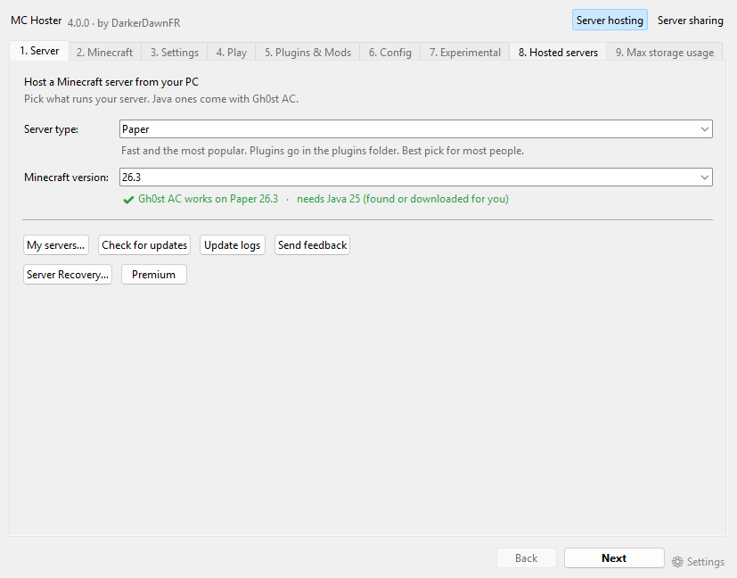

# MC Hoster

Host a Minecraft server from your own PC in four clicks, with **Gh0st AC** already installed. By DarkerDawnFR.

**Download:** [`dist/MC-Hoster.exe`](dist/MC-Hoster.exe) (Windows, nothing else to install — Java is found or downloaded for you).



## How it works
It looks and works like the Fabric Installer: tabs across the top, **Back / Next** at the bottom.

1. **Server**: pick the server type and the Minecraft version. You get every type Gh0st AC runs on:
   | Type | Versions offered | Gh0st AC jar |
   |---|---|---|
   | Paper | 1.20.6 to the newest 26.x | `plugins/` |
   | Purpur | 1.20.6 to the newest | `plugins/` |
   | Pufferfish | its newest 1.21 build | `plugins/` |
   | Spigot | 1.20.6 to the newest (compiled on your PC with BuildTools, 5-10 min) | `plugins/` |
   | Fabric | 1.21.1 (+ Fabric API) | `mods/` |
2. **Minecraft**: finds your `.minecraft` folder by itself (or pick it with **…**). It is used to add the server to your Multiplayer list and to reuse the Java the Minecraft Launcher already downloaded. You can skip it.
3. **Settings**: the last tab before the server is made.
   - **Name** (just a name: the server list and the MOTD)
   - **Icon**: a 64×64 PNG. A different size is refused, with an offer to shrink it for you.
   - **Max players**: the bar under it goes green → yellow → orange → red as your PC will lag more, and shows how much RAM the server will get (more players = more RAM, never more than 60 % of your PC)
   - **Game mode** (Survival, Creative, Adventure, Spectator) and **Difficulty** (Peaceful, Easy, Normal, Hard, + Hardcore)
   - **Gh0st AC** (on by default, free version)
   - Minecraft EULA (you have to agree to it to run any server)
   - The button here is **Finish**, not Next.
4. **Play**: downloads everything, starts the server and shows **the IP**:
   - **Friends**: your public IP. MC Hoster tries to open port 25565 on your router by itself (UPnP). If the router says no, it tells you which port to forward.
   - **Same Wi-Fi**: your LAN IP
   - **This PC**: `localhost`
   
   Plus the live console, a command box, Stop/Start and Open folder.

Servers are saved in `Documents\MC Hoster Servers\<name>`. Start them again from **My servers…** on the first tab, or with `start.bat` in the folder.


## Building
`pip install pyinstaller pillow`, then
```
pyinstaller --onefile --windowed --name MC-Hoster --icon assets/icon.ico --add-data "assets;assets" --add-data "gh0stac;gh0stac" MC-Hoster.py
```
GitHub Actions does this on every push, clicks through every tab of the real exe, sets up and starts a real server of every type (Paper latest / 1.21.1 / 1.20.6, Fabric 1.21.1, Purpur, Pufferfish, Spigot) and checks that Gh0st AC loaded, then commits `dist/MC-Hoster.exe` and the screenshots.

`python MC-Hoster.py --selftest paper latest` runs the same server test on your PC.

## Gh0st AC jars
`gh0stac/` holds the Fabric and Bukkit jars, built by the `mc-hoster-jars` branch of the Gh0stAC repo. To update them, push to that branch and copy `jars/*.jar` here.
