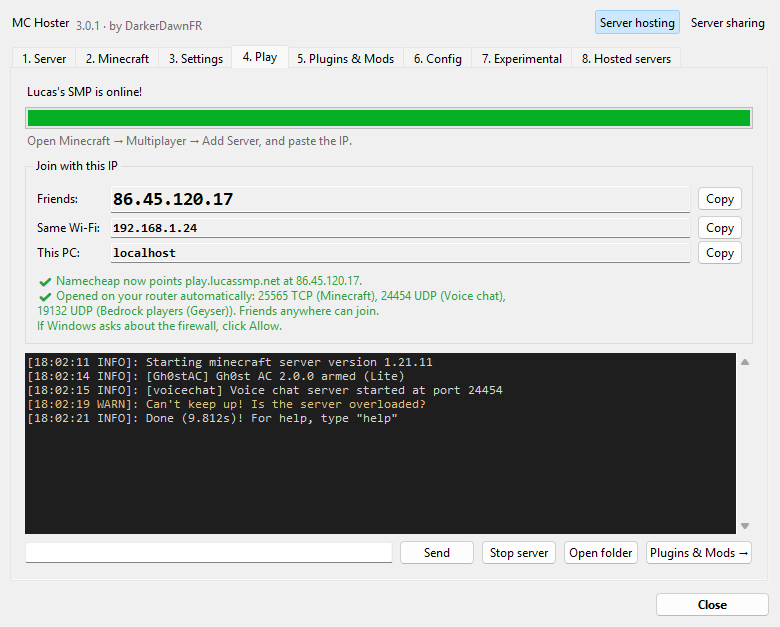

# MC Hoster

Host a Minecraft server from your own PC in a few clicks, Java or Bedrock, with **Gh0st AC** already installed. By DarkerDawnFR.

**Download:** [`dist/MC-Hoster.exe`](dist/MC-Hoster.exe) (Windows, nothing else to install: Java is found or downloaded for you).


## The tabs
It looks and works like the Fabric Installer: tabs across the top, **Back / Next** at the bottom.

1. **Server**: the server type and version.
   | Type | Versions | Gh0st AC | Plugins & Mods |
   |---|---|---|---|
   | Paper | 1.20.6 to the newest 26.x | ✔ | plugins |
   | Purpur | 1.20.6 to the newest | ✔ | plugins |
   | Pufferfish | its newest 1.21 build | ✔ | plugins |
   | Spigot | 1.20.6 to the newest (compiled on your PC, 5-10 min) | ✔ | plugins |
   | Fabric | 1.21.1 (+ Fabric API) | ✔ | mods |
   | **Bedrock** | the newest Bedrock Dedicated Server from Mojang | Java only | none (use Paper + Geyser to mix) |
2. **Minecraft**: finds your `.minecraft` folder (or your Minecraft Bedrock folder) and adds the server to your server list.
3. **Settings**: name, 64×64 PNG icon, **max players up to 1500** (over 100 asks 2 times, over 500 asks 5 times, over 1000 asks 7 times), game mode, difficulty + hardcore, **Auto-start** (scheduler), **Custom IP**, Gh0st AC, EULA. Then **Finish**.
4. **Play**: the IPs with Copy buttons (your custom address, friends, same Wi-Fi, this PC), automatic port opening on your router (UPnP), live console, commands, Stop/Start.
5. **Plugins & Mods**: tick presets and click **Apply & restart**:
   - Plugins: Simple Voice Chat, Vanish (SuperVanish), RoseStacker, EssentialsX, LuckPerms, WorldEdit, CoreProtect, Geyser + Floodgate, ViaVersion, Chunky, spark, BlueMap
   - Fabric mods: Simple Voice Chat, Vanish, Vault, LuckPerms, WorldEdit, Ledger, Geyser + Floodgate, Chunky, spark, BlueMap, Lithium, FerriteCore

   Downloaded for your exact version (Modrinth, Hangar, GeyserMC), with their required libraries. Unticking removes them. Their ports (voice chat 24454 UDP, Geyser 19132 UDP, BlueMap 8100) are opened too.

**After Finish, every tab can be clicked.** Change anything in 1, 2, 3 or 5 and press **Apply & restart**: the server stops (world saved), the changes are applied, and it starts again. In tab 1 you can update to a newer version (never older, that would break the world).

### Auto-start (scheduler)
Settings → Auto-start → **Schedule…**: **Once** (a date), **Daily**, **Weekly** (pick days), **Monthly** (that day every month) or **Yearly** (that date every year), at a time you pick. It makes a Windows scheduled task (`MC Hoster\<server>`) that opens MC Hoster and starts the server, if the PC is on.

### Custom IP
Settings → Custom IP → **Set up…**. Friends join with `play.yourdomain.com` instead of numbers. Every start, MC Hoster sends your current IP to the domain (Dynamic DNS), so it keeps working when your home IP changes.
- **Namecheap**: Domain List → Manage → Advanced DNS → turn on **Dynamic DNS**, copy the password into MC Hoster, and add an **A + Dynamic DNS Record** with your host (e.g. `play`).
- **DuckDNS**: free `yourname.duckdns.org`, uses your DuckDNS token.
- **Other**: you set the A record yourself; MC Hoster shows the IP to use.

The password is saved in that server's `mchoster.json` on your PC.

Servers are saved in `Documents\MC Hoster Servers\<name>`. Open them again with **My servers…**, or `start.bat`.




## Building
`pip install pyinstaller pillow`, then
```
pyinstaller --onefile --windowed --name MC-Hoster --icon assets/icon.ico --add-data "assets;assets" --add-data "gh0stac;gh0stac" MC-Hoster.py
```
GitHub Actions builds it on every push and tests on Windows: a real server of every type (Paper latest / 1.21.1 / 1.20.6, Fabric, Purpur, Pufferfish, Spigot, Bedrock) started and checked for Gh0st AC, Paper and Fabric started again with **every** preset plugin/mod installed, every preset downloadable for each type, and real scheduled tasks for every repeat type. Then it commits `dist/MC-Hoster.exe` and the screenshots.

To publish a release: Actions → **Release** → Run workflow, type the version (e.g. `v1.1.0`).

## Gh0st AC jars
`gh0stac/` holds the Fabric and Bukkit jars, built by the `mc-hoster-jars` branch of the Gh0stAC repo.
