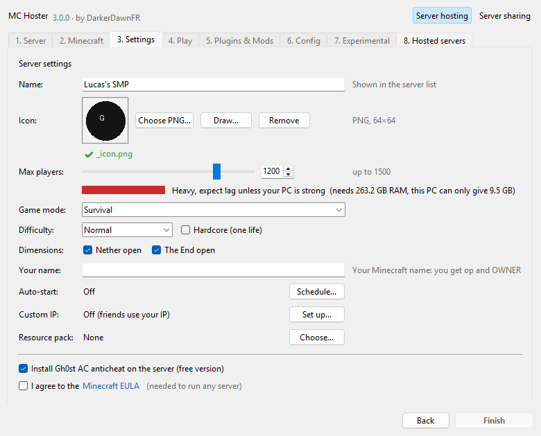
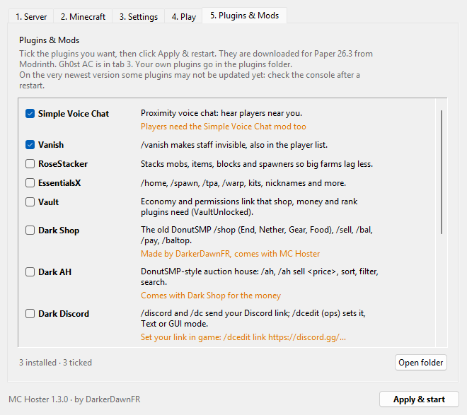

# MC Hoster

Host a Minecraft server from your own PC in a few clicks, Java or Bedrock, with **Gh0st AC** already installed. By DarkerDawnFR.

**Download:** [`dist/MC-Hoster.exe`](dist/MC-Hoster.exe) (Windows, nothing else to install: Java is found or downloaded for you).



## The tabs
It looks and works like the Fabric Installer: tabs across the top, **Back / Next** at the bottom.

1. **Server**: the server type and version.
   | Type | Versions | Gh0st AC | Plugins & Mods |
   |---|---|---|---|
   | Paper | 1.20.6 to the newest 26.x | ✔ | plugins |
   | Purpur | 1.20.6 to the newest | ✔ | plugins |
   | Pufferfish | its newest 1.21 build | ✔ | plugins |
   | Spigot | 1.20.6 to the newest (compiled on your PC, 5-10 min) | ✔ | plugins |
   | Fabric | 1.21.1 (+ Fabric API) | ✔ | mods |
   | **Bedrock** | the newest Bedrock Dedicated Server from Mojang | Java only | none (use Paper + Geyser to mix) |
2. **Minecraft**: finds your `.minecraft` folder (or your Minecraft Bedrock folder) and adds the server to your server list.
3. **Settings**: name, 64×64 PNG icon, **max players up to 1500** (over 100 asks 2 times, over 500 asks 5 times, over 1000 asks 7 times), game mode, difficulty + hardcore, **Nether and End on/off**, **Your name** (you get op and the OWNER rank), **Auto-start** (scheduler), **Custom IP**, Gh0st AC, EULA. Then **Finish**.
4. **Play**: the IPs with Copy buttons (your custom address, friends, same Wi-Fi, this PC), automatic port opening on your router (UPnP), live console, commands, Stop/Start.
5. **Plugins & Mods**: tick presets and click **Apply & restart**:
   - Plugins: Simple Voice Chat, Vanish (SuperVanish), RoseStacker, Vault, **Dark Shop**, **Dark AH**, **Dark Discord**, **Dark RTP**, **Dark Scoreboard**, **Dark Homes**, **Dark TPA**, **Dark Hub**, **Dark Combat**, **Dark Shards**, **Dark Rifts**, **Dark Essentials**, **Dark Chat**, **Dark Performance**, **Dark Backup**, **Dark Crates**, **Dark Tips**, **Dark Bossbar**, **Dark Announce**, **Dark Spawners**, **Dark Settings**, **Dark Duels**, **Dark Ranks**, **Dark Perks**, **Dark VC Add-on**, **Dark RS Add-on**, **Dark Teams**, **Dark Hates Griefers**, **Dark AFK Zone**, EssentialsX, LuckPerms, WorldEdit, CoreProtect, Geyser + Floodgate, ViaVersion, Chunky, spark, BlueMap
   - Fabric mods: Simple Voice Chat, Vanish, LuckPerms, WorldEdit, Ledger, Geyser + Floodgate, Chunky, spark, BlueMap, Lithium, FerriteCore

   The **Dark plugins** are made by DarkerDawnFR and come inside MC Hoster (source in `plugins/`):
   - **Dark Shop**: the old DonutSMP `/shop` (End, Nether, Gear, Food, amount menu), `/sell`, `/worth`, `/bal`, `/pay`, `/baltop`, `/eco`, `/baltop` as a menu of player heads, and `/bounty` (put money on someone, their killer gets it). Uses EssentialsX/Vault money if there is one, its own otherwise (and shares it through Vault).
   - **Dark AH**: DonutSMP-style `/ah`: `/ah sell <price>`, sort, filter, search, Your Items, 48-hour listings, and what sold while you were offline when you log in.
   - **Dark RTP**: `/rtp` (menu: Overworld, Nether, End, 5-second countdown, safe spots only), `/rtpqueue` or `/rtpq` (matched with another player, both sent to the same spot).
   - **Dark Scoreboard**: the old DonutSMP sidebar (titled *Test SMP*: money, kills, deaths, bounty, playtime, online, ping) and tab list header/footer/names. Reads money, bounty, baltop rank, /ah listings, /rtpq and the Discord link from the other Dark plugins, plus PlaceholderAPI. Ops edit everything in game with `/dsb edit`; anyone can hide theirs with `/dsb toggle`.
   - **Dark Homes**: the modern DonutSMP `/home` menu (a bed per home, delete buttons), `/sethome`, `/delhome`. 5 homes, more with `darkhomes.homes.<n>`.
   - **Dark TPA**: `/tpa`, `/tpahere`, `/tpaccept`, `/tpdeny`, `/tpacancel`, `/tpauto` (auto-accept), and `/tp`, `/tphere` for ops.
   - **Dark Hub**: `/hub` menu with a bed per hub (own names, 100 players each) and a Random Hub button at the end. Ops set them with `/hubset <number> [name]`. You respawn at your hub if you have no bed.
   - **Dark Combat**: 20-second combat tag in dark colours above the hotbar; no teleporting, logging out kills you, 15-second ender pearl cooldown. `/combat time <seconds>` changes it.
   - **Dark Shards**: shards for playing and killing players, `/shards` shop with 24-hour shard tools (the Shard Pickaxe is an amethyst shard that mines 3x3), purple particles and amethyst sounds. Every item is editable in its config.
   - **Dark Rifts** (original): a purple rift opens somewhere in the world every 45 minutes. Stand in it to charge it, but it only charges while one player holds it, and mobs come in waves. Whoever held it longest gets money, shards and loot. `/rift` shows where it is and points your compass at it.
   - **Dark Essentials**: `/spawn`, `/setspawn`, `/back`, kits (starter + daily, `/kit`), join/leave/first-join messages, welcome title, AFK, `/rules`.
   - **Dark Chat**: rank prefixes (LuckPerms), @mentions with a ping, `[item]` in chat, anti-spam/caps/filter, `/msg`, `/r`, `/ignore`, `/mute`, `/mutechat`, `/clearchat`, `/socialspy`.
   - **Dark Performance**: `/tps`, clears ground items every 10 minutes (with warnings), mob limits per chunk, view distance drops by itself when the server lags.
   - **Dark Backup**: zips the worlds every 6 hours while the server runs, keeps the newest 10, `/backup now`.
   - **Dark Crates**: crates on chests / ender chests / shulker boxes (`/crate look set <crate>`), `/crate add <name>` and the `/crate edit` editor, keys you right-click to use (they count for their crate), a spinning roll from bad to great loot, a Keys page in `/shards`, Key All every hour (on the scoreboard).
   - **Dark Tips**: a tip every few minutes and a login announcement, all changed with `/tips`.
   - **Dark Bossbar**: a boss bar with your IP (MC Hoster fills in `{ip}`), any colour, flashing; `/bar`.
   - **Dark Announce**: `/announce <message>` and `/donor <player> <package>` (fireworks, works from the console for stores).
   - **Dark Spawners**: DonutSMP-style spawners that fill with loot and XP instead of spawning mobs; stack them, sell all, collect XP. Bought on page 3 of `/shards`.
   - **Dark Settings**: `/settings` (night vision, mob spawns, scoreboard, boss bar, chat, private messages, mention pings, TPA requests, payments, tips). The other Dark plugins follow it.
   - **Dark Duels**: `/duel <player> [bet]` in arenas you set with `/duel arena set <name> 1|2`; nobody loses items, winner takes the bet, stats.
   - Dark Shop also has **`/orders`** (buy orders), and Dark Essentials gives **starter gear** (chainmail, 16 steak, stone tools, gray bold "Starter ...", can't be sold or auctioned) to anyone who spawns with nothing.
   - **Dark Ranks**: ranks with permissions (like LuckPerms) and a custom tag with an icon in chat and the tab list (`♛ OWNER`, `▶ MEDIA`). `/rank shop` sells VIP, VIP+, MVP, MVP+ and LEGEND for money; staff ranks (Media, Mod, Admin, Owner) with `/rank add <player> <rank>`. `/rank edit` changes everything in game.
   - **Dark Perks**: commands only ranks get: `/craft`, `/hat`, `/ec`, `/feed`, `/fly`, `/nick`, `/repair`, `/glow`, `/heal`, `/trail`.
   - **`/shop premium`** for ranks: better deals and things the normal shop doesn't have, with a bigger discount for better ranks (5% VIP up to 15% LEGEND). **`/media`** shows what's needed for the Media rank. **Playtime money**: every 30 minutes of real (not AFK) playing, more the longer you've played. Over 200 items can be sold with `/sell`, and sell values show in the shop, `/ah`, `/orders`, spawners, and above the hotbar for the item you hold.
   - **Dark VC Add-on**: voice chat only after `/voicechat agree` and accepting the rules in a pop-up (installs Simple Voice Chat too).
   - **Dark Hates Griefers**: protected areas (`/dhg set 1`, `/dhg set 2` or `/dhg wand`, `/dhg create <name>`): nobody breaks or places blocks, no explosions, fire, pistons or lava; `/dhg allow <player>` lets someone build.
   - **Dark AFK Zone**: 10 shards every minute in the AFK zone (`/afkzone` to go there; ops make it like Dark Hates Griefers).
   - **Dark Teams**: DonutSMP-style `/team` (menu, create, invite, join, leave, kick, transfer, disband), team home, team chat (`/tc`), no friendly fire (`/team pvp`), `/team top`. `{team}` on the scoreboard and in chat.
   - **Dark RS Add-on**: RoseStacker mob/item stacking on/off per player in `/settings` for the area around you (stacks there get split up); where areas overlap, whoever arrived first decides (installs RoseStacker too; RoseStacker doesn't run on 26.x yet).
   - Dark Shop also shows **money under name tags**, has **`/rules`** and **`/stats [player]`**, and shows both the **sell value** and the **auction value** (from real `/ah` sales) on items.
   - Better ranks get `/ec` (from VIP), more homes (up to 20 for LEGEND), a better respawn kit and a `/sell` boost (1.05x VIP up to 1.25x LEGEND). **Random Coords** in `/settings` hides your real coordinates on the scoreboard, `/home` and `/rtp` for streaming.
   - Editors for ops: `/shop edit`, `/shards edit`, `/rank edit`, `/dsb edit`.
   - Every teleport (home, hub, tpa, tp, rtp, spawn, back) is a 5-second countdown you can't move in, and is blocked in combat.
   - **Dark Discord**: `/discord` (link to everyone), `/dc` (only you, 5 seconds on screen), `/dcedit` (ops: link, Text or GUI mode).

   Downloaded for your exact version (Modrinth, Hangar, GeyserMC), with their required libraries. Unticking removes them. Their ports (voice chat 24454 UDP, Geyser 19132 UDP, BlueMap 8100) are opened too.

**Updates**: MC Hoster checks for a new version when it opens and shows what's new; one click installs it (or use **Check for updates** on the first tab).

**After Finish, every tab can be clicked.** Change anything in 1, 2, 3 or 5 and press **Apply & restart**: the server stops (world saved), the changes are applied, and it starts again. In tab 1 you can update to a newer version (never older, that would break the world).

**A server can't keep running after MC Hoster closes.** It's tied to MC Hoster, so closing MC Hoster (or a crash, or ending it in Task Manager) stops it too. A server left running by an older MC Hoster is found when MC Hoster opens and before every start, and you can stop it. If something else is using the port, MC Hoster offers another port.

### Auto-start (scheduler)
Settings → Auto-start → **Schedule…**: **Once** (a date), **Daily**, **Weekly** (pick days), **Monthly** (that day every month) or **Yearly** (that date every year), at a time you pick. It makes a Windows scheduled task (`MC Hoster\<server>`) that opens MC Hoster and starts the server, if the PC is on.

### Custom IP
Settings → Custom IP → **Set up…**. Friends join with `play.yourdomain.com` instead of numbers. Every start, MC Hoster sends your current IP to the domain (Dynamic DNS), so it keeps working when your home IP changes.
- **Namecheap**: Domain List → Manage → Advanced DNS → turn on **Dynamic DNS**, copy the password into MC Hoster, and add an **A + Dynamic DNS Record** with your host (e.g. `play`).
- **DuckDNS**: free `yourname.duckdns.org`, uses your DuckDNS token.
- **Other**: you set the A record yourself; MC Hoster shows the IP to use.

The password is saved in that server's `mchoster.json` on your PC.

Servers are saved in `Documents\MC Hoster Servers\<name>`. Open them again with **My servers…**, or `start.bat`.




## Building
`pip install pyinstaller pillow`, then
```
pyinstaller --onefile --windowed --name MC-Hoster --icon assets/icon.ico --add-data "assets;assets" --add-data "gh0stac;gh0stac" MC-Hoster.py
```
GitHub Actions builds it on every push and tests on Windows: a real server of every type (Paper latest / 1.21.1 / 1.20.6, Fabric, Purpur, Pufferfish, Spigot, Bedrock) started and checked for Gh0st AC, Paper and Fabric started again with **every** preset plugin/mod installed, every preset downloadable for each type, and real scheduled tasks for every repeat type. Then it commits `dist/MC-Hoster.exe` and the screenshots.

To publish a release: Actions → **Release** → Run workflow, type the version (e.g. `v1.1.0`).

## Gh0st AC jars
`gh0stac/` holds the Fabric and Bukkit jars, built by the `mc-hoster-jars` branch of the Gh0stAC repo.
